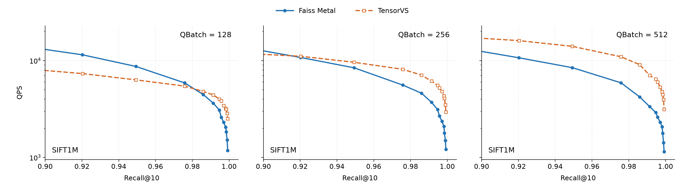

# TensorVS

Tensor-native IVF vector search with cross-query data reuse and shared PQ lookup tables.

[Design](#design) · [Quick Start](#quick-start) · [Search Backends](#search-backends) · [Benchmarks](#benchmarks) · [Development](#development)

---

TensorVS is an IVF-based vector search engine built around tensor operations. It reorganizes IVF-Flat scanning to reuse vectors across queries, and reformulates residual IVF-PQ distance computation around a lookup table shared by all lists probed by a query. A portable PyTorch path and a specialized Triton path implement these ideas for different hardware.

## Key Features

- **Reuse IVF-Flat vectors across queries.** List-major scanning groups queries that probe the same list, so a vector tile can be used by multiple queries in batched matrix multiplication. Work is tiled across queries and candidates to handle long or frequently probed lists.
- **Build one PQ lookup table per query.** TensorVS moves the list-dependent residual-PQ term into a precomputed per-vector correction. The resulting query-dependent table is shared across probed lists, avoiding a separate table for every query–list pair.
- **Run the same search logic across tensor backends.** The PyTorch implementation expresses search through standard tensor operations for CPU, CUDA, and Apple Silicon MPS. A complementary Triton implementation fuses scan and local selection on supported CUDA configurations.
- **Bound intermediate search work.** Candidate blocks produce local top-k results that are merged per query, with a configurable PyTorch scan/merge workspace budget. IVF-PQ can optionally rerank candidates using external original vectors.

## Design

### IVF-Flat: share work across queries

Query-major GPU scans commonly process each query or query–list pair independently. When queries probe the same list, they can repeatedly load the same full-precision vectors. TensorVS instead supports **list-major scanning**: it groups queries by their selected lists, tiles both the queries and candidate vectors, and computes distances with batched matrix operations. This shares candidate data across queries and splits long or heavily probed lists into smaller units of work. Local top-k results are then merged for each query.

The PyTorch backend also has an adaptive dense path for suitable CUDA workloads, and exposes `torch_flat_scan` to select `grouped`, `dense`, or `auto`. The Triton path uses an interleaved layout and fuses distance computation with local selection. Which strategy is faster depends on query overlap, list sizes, batch size, and hardware.

### IVF-PQ: share a lookup table across lists

Residual IVF-PQ normally combines a query, a list centroid, and PQ codewords when estimating a candidate's distance. TensorVS separates those terms: it builds one **query-dependent lookup table** shared across the query's probed lists, and stores a precomputed scalar correction with each encoded vector. During scanning it combines the lookup values, correction, and query–centroid distance. This rearranges the residual-PQ distance calculation while trading extra per-vector storage and reads for less list-dependent lookup-table work. Floating-point precision and operation order can affect numerical results; the LUT storage precision is configurable.

The PyTorch implementation uses tensor indexing, reduction, and top-k in bounded blocks. The Triton IVF-PQ path scans compact codes in query-major work units and fuses lookup, accumulation, and local selection; unlike IVF-Flat, its compressed candidates and shared per-query table favor a different scheduling choice. Both paths retain the same index-level distance formulation.

### Portable execution, specialized layouts

The PyTorch path uses contiguous list data and standard tensor operators; supported CUDA configurations can instead use Triton with interleaved layouts and fused kernels. Layouts are derived from the same saved index, allowing backend selection without retraining. The implementation does not require custom Metal kernels to search on MPS. Portability and performance depend on the PyTorch device backend and workload.

## Quick Start

TensorVS requires Python 3.11 or later. Clone the repository with its `flash-kmeans` submodule and install it in an environment with PyTorch:

```bash
git clone --recurse-submodules https://github.com/SongYitong826/TensorVS.git
cd TensorVS
python -m pip install -e .
```

The submodule is configured with a GitHub SSH URL, so cloning it requires GitHub SSH access. If you already cloned the repository, run `git submodule update --init --recursive` before installing. For CUDA configurations using Triton, install the optional dependency with `python -m pip install -e '.[triton]'`.

Build an IVF-Flat index from generated vectors, save it, and search it on CPU:

```python
import torch
from tensorvs import (
    build_ivfflat_index,
    load_ivfflat_index,
    save_ivfflat_index,
    search_ivfflat_index,
)

torch.manual_seed(7)
vectors = torch.randn(1024, 16)
queries = vectors[:5].clone()

build = build_ivfflat_index(
    vectors, nlist=8, niter=5, use_triton=False, device="cpu"
)
save_ivfflat_index(build, "./ivfflat-index")
index = load_ivfflat_index("./ivfflat-index")

distances, ids = search_ivfflat_index(
    index, queries, topk=5, nprobe=4, device="cpu", backend="torch"
)
print(ids)        # shape: (5, 5), IDs refer to rows in vectors
print(distances)  # squared L2 distances
```

For real datasets, `load_dataset` reads `.fvecs`, `.npy`, and `.pt`/`.pth` files. See [IVF-Flat](examples/ivfflat_search.py) and [IVF-PQ](examples/ivfpq_search.py) for complete build and search examples; edit their dataset paths and parameters before running them.

## IVF-PQ and Refinement

IVF-PQ trains a coarse quantizer and product quantizers on residuals. `m` sets the number of PQ subspaces and `nbits` sets the codebook size per subspace. The index stores compressed codes rather than original vectors.

```python
from tensorvs import (
    build_ivfpq_index,
    load_ivfpq_index,
    save_ivfpq_index,
    search_ivfpq_index,
)

# vectors and queries are two-dimensional PyTorch tensors with the same dimension.
build = build_ivfpq_index(
    vectors, nlist=8, niter=5, use_triton=False, device="cpu", m=4, nbits=4
)
save_ivfpq_index(build, "./ivfpq-index")
index = load_ivfpq_index("./ivfpq-index")

distances, ids = search_ivfpq_index(
    index, queries, topk=5, nprobe=4, device="cpu", backend="torch",
    refine_vectors=vectors, refine_factor=4,
)
```

Here refinement selects up to 20 approximate candidates per query and returns the best five using exact squared L2 distances. Pass the original vectors in their original row order; omit `refine_vectors` and `refine_factor` to return PQ distances directly. Training options for the coarse and PQ stages can be configured independently; see [`build_ivfpq_index`](src/tensorvs/index_ivfpq.py).

## Search Backends

| Backend | Devices | Behavior |
| --- | --- | --- |
| `auto` | CPU, MPS, CUDA | Selects Triton for supported configurations; otherwise uses PyTorch. |
| `torch` | CPU, MPS, CUDA | Uses standard PyTorch operations and bounded scan/merge workspaces. |
| `triton` | Supported CUDA configurations | Uses fused Triton search; unsupported devices or shapes raise an error. |

Set `device` explicitly to choose where search runs. If omitted, queries already on a non-CPU device keep that device; otherwise TensorVS chooses CUDA, then MPS, then CPU. `backend` and `device` are independent settings. The examples train on CPU when using MPS for search because some training operations are unavailable on MPS.

The PyTorch backend exposes `torch_query_batch_size`, `torch_candidate_chunk_size`, and `torch_memory_budget_mb` for managing scan workspaces. The budget does not include the resident index, inputs and outputs, or internal compiler and library workspaces. `use_compile=True` enables `torch.compile` for supported PyTorch search blocks; compilation and performance depend on the device and workload.

Execution layouts are cached by default under `~/.cache/tensorvs/layouts`. Set `TENSORVS_LAYOUT_CACHE_DIR` to change the cache location, or pass `persist_layout=False` to disable persistent layout caching.

## Benchmarks

The repository includes QPS–Recall@10 comparisons on SIFT1M and GloVe1.2M for IVF-Flat and IVF-PQ, with query batches of 128, 256, and 512. Curves show the measured performance frontier; the CSV files retain all measured points and configuration details.

| Dataset | IVF-Flat | IVF-PQ | Raw results |
| --- | --- | --- | --- |
| SIFT1M | [Figure](plot/Figures/SIFT1M_IVFFlat_QBatch128_256_512_K10.png) | [Figure](plot/Figures/SIFT1M_IVFPQ_QBatch128_256_512_K10.png) | [Flat](results/sift1m_ivfflat.csv) · [PQ](results/sift1m_ivfpq.csv) |
| GloVe1.2M | [Figure](plot/Figures/GloVe1.2M_IVFFlat_QBatch128_256_512_K10.png) | [Figure](plot/Figures/GloVe1.2M_IVFPQ_QBatch128_256_512_K10.png) | [Flat](results/glove1.2m_ivfflat.csv) · [PQ](results/glove1.2m_ivfpq.csv) |



These results were measured on Apple M5. TensorVS uses MPS for both indexes; the local Faiss Metal comparison uses GPU search for IVF-Flat and four CPU threads for IVF-PQ. TensorVS inputs and outputs reside on MPS, while Faiss API timing includes its internal transfers. The comparison imports the same trained index into Faiss; it does not retrain it. Results depend on hardware, software, and workload, and the two timed paths have different device and transfer behavior.

The [comparison script](bench/compare_mps_faiss.py) expects dataset queries and ground truth, prebuilt TensorVS indexes, and a local Faiss Metal build. For example:

```bash
python bench/compare_mps_faiss.py --dataset /path/to/sift1m --faiss-root /path/to/faiss-metal
python plot/qbatch_comparison.py
```

The script refuses to overwrite existing result CSVs. Use a different `--output-dir` for a new run. See the script's `--help` for dataset and measurement options.

## Development

Install development dependencies and run the tests:

```bash
python -m pip install -e '.[dev]'
python -m pytest
```

The project package is in [`src/tensorvs`](src/tensorvs/); [`tests`](tests/) covers training, indexes, and search backends. Additional experiments and benchmark tools live in [`bench`](bench/) and [`plot`](plot/).
