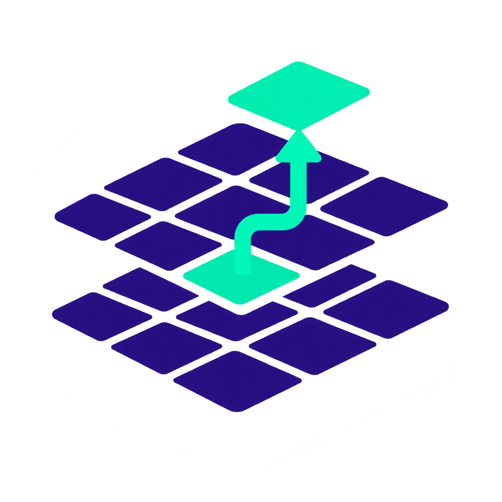
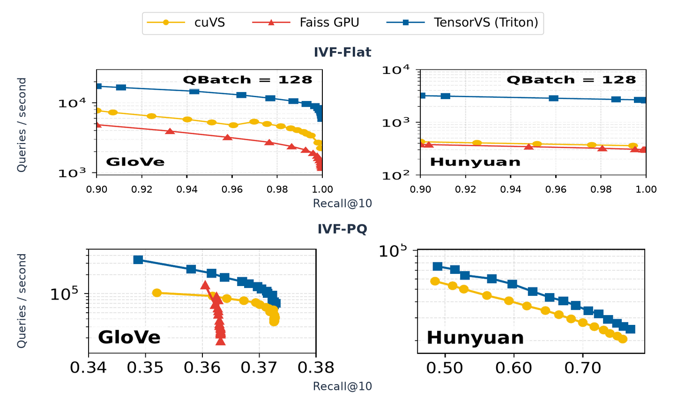
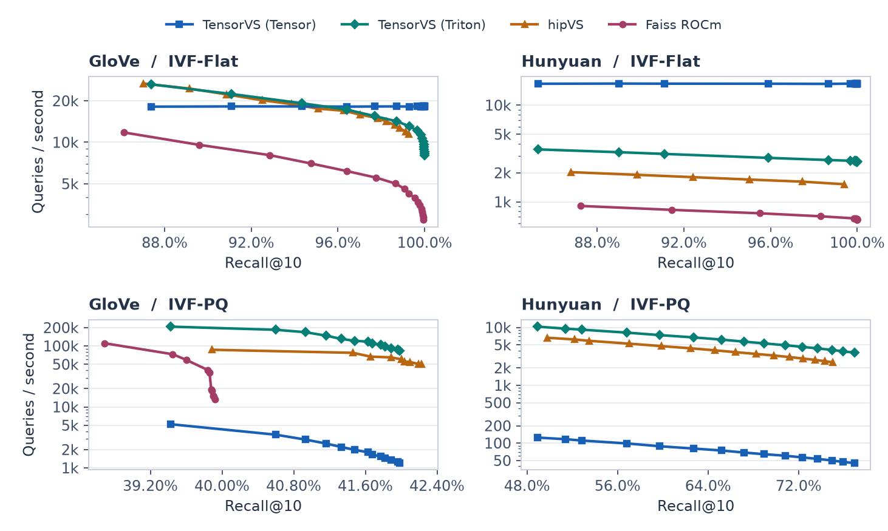
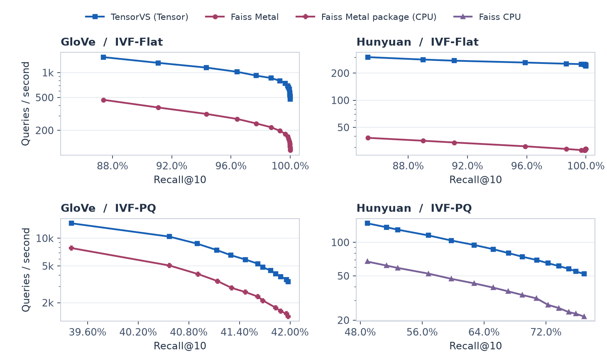
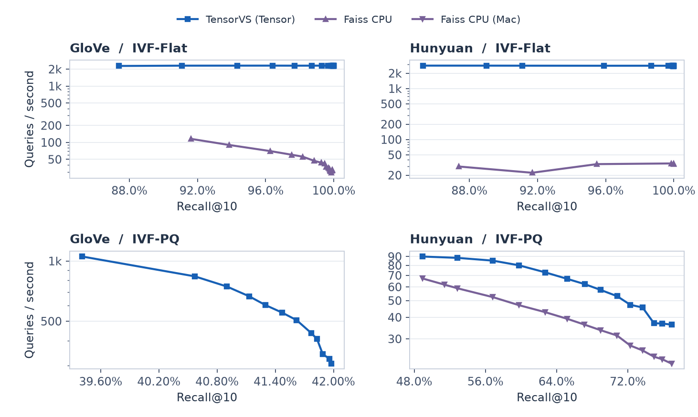

<p align="center">
  
</p>

<h1 align="center">TensorVS</h1>

<p align="center"><strong>Tensor-native vector search for heterogeneous accelerators.</strong></p>

<p align="center">
  <a href="#quick-start">Quick Start</a> ·
  <a href="#benchmarks">Benchmarks</a> ·
  <a href="docs/usage-and-benchmarks.md">Usage &amp; Reproduction</a>
</p>

---

- **Two execution paths.** Run the same saved IVF index with portable PyTorch tensor operations or fused Triton kernels on supported GPUs.
- **IVF-Flat reuses vectors across queries.** Adaptive list-major tiling groups queries probing the same list, balances work across scan tasks, and merges local results with packed-key top-k on the Triton path.
- **IVF-PQ builds one lookup table per query.** A precomputed per-vector correction lets every probed list share the table, so the cost and storage of building it are independent of `nprobe`.

## Benchmarks

**GloVe 1.2M and Tencent Hunyuan.** Queries per second versus Recall@10 with batch size 128 and 1,024 IVF lists. Each line sweeps the number of probed lists.

**NVIDIA RTX 4090 · CUDA**



<details>
<summary><strong>AMD MI300X VF · ROCm</strong></summary>



</details>

<details>
<summary><strong>Apple M5 · Metal / MPS</strong></summary>



</details>

<details>
<summary><strong>Huawei Ascend 910B4 · NPU</strong></summary>



The GloVe IVF-PQ Faiss Ascend run uses inner-product ground truth. This panel shows the squared-L2 TensorVS run.

</details>

[Benchmark sources and reproduction](docs/usage-and-benchmarks.md#readme-figures)

## Quick Start

Python 3.11+ with PyTorch. The `flash-kmeans` submodule currently uses GitHub SSH.

```bash
git clone --recurse-submodules https://github.com/SongYitong826/TensorVS.git
cd TensorVS
python -m pip install -e .
```

```python
import torch
from tensorvs import (
    build_ivfflat_index,
    load_ivfflat_index,
    save_ivfflat_index,
    search_ivfflat_index,
)

torch.manual_seed(7)
vectors = torch.randn(1024, 16)
build = build_ivfflat_index(vectors, nlist=8, niter=5, device="cpu", use_triton=False)
save_ivfflat_index(build, "./ivfflat-index")

index = load_ivfflat_index("./ivfflat-index")
distances, ids = search_ivfflat_index(
    index, vectors[:5], topk=5, nprobe=4, device="cpu", backend="torch",
)
```

[IVF-PQ and exact reranking](docs/usage-and-benchmarks.md#ivf-pq-and-refinement) ·
[Backend setup](docs/usage-and-benchmarks.md#search-backends) ·
[Examples](examples/)
