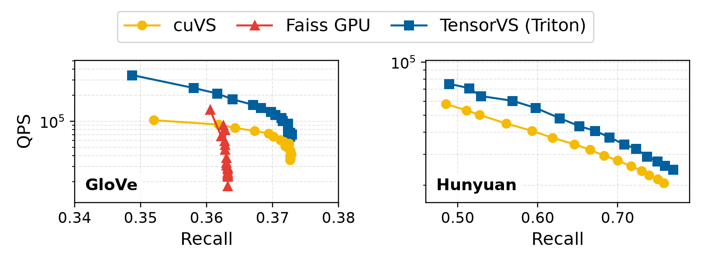
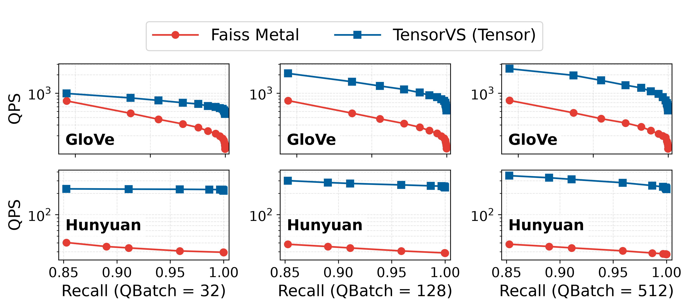
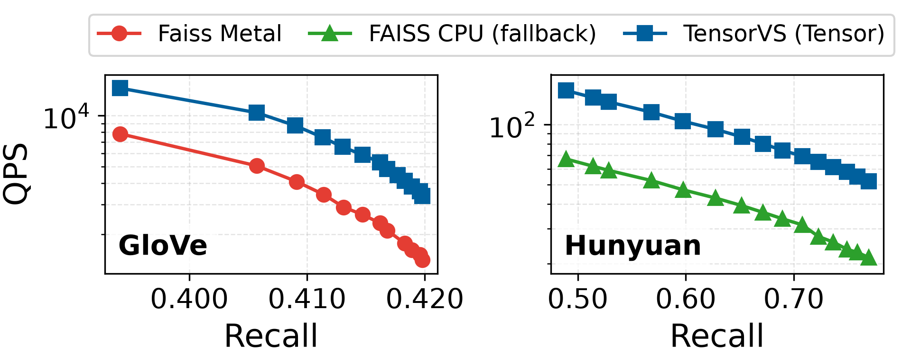
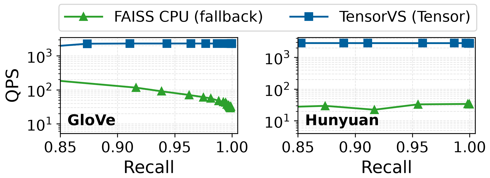
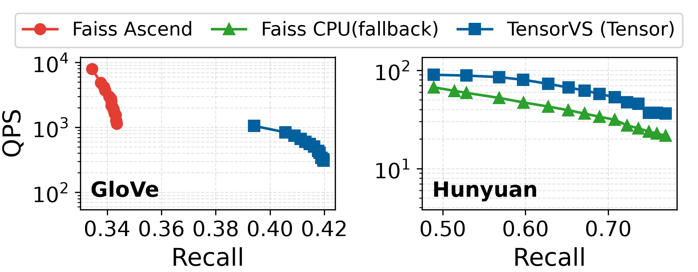

# TensorVS Benchmarks

## NVIDIA RTX 4090 · CUDA

### IVF-Flat

### IVF-PQ

## AMD MI300X VF · ROCm

### IVF-Flat

### IVF-PQ

## Apple M5 · Metal / MPS

### IVF-Flat

### IVF-PQ

## Huawei Ascend 910B4 · NPU

### IVF-Flat

### IVF-PQ

