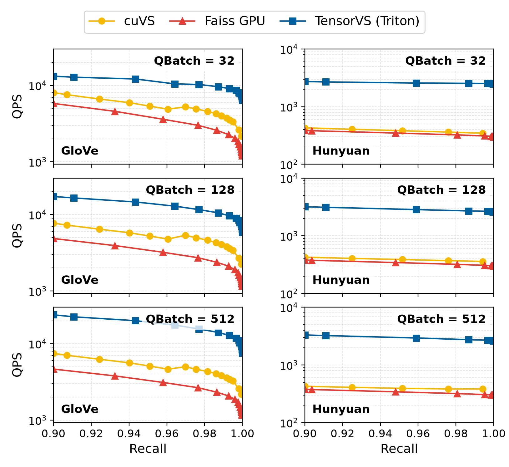
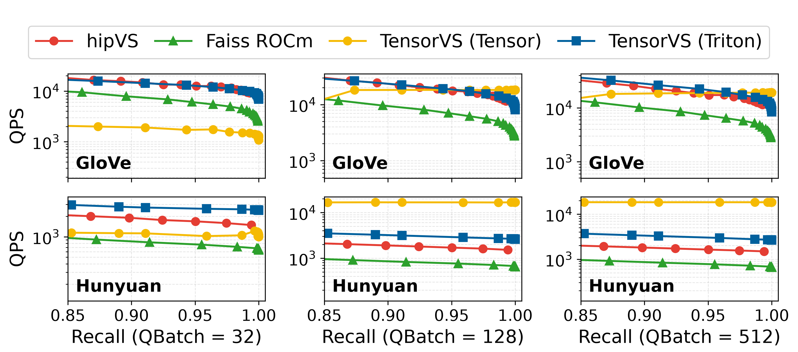
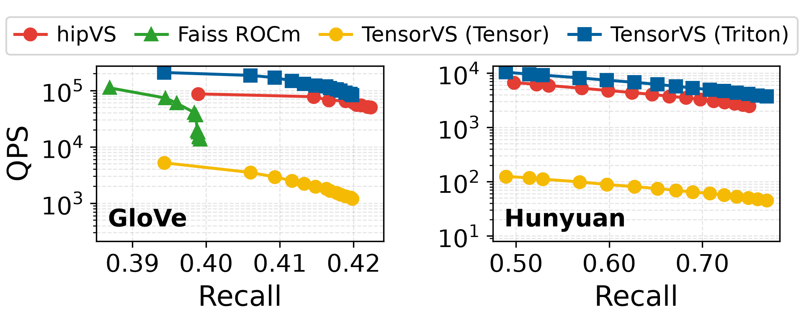

# TensorVS Benchmarks

[Back to TensorVS](../README.md) · [Reproduce the figures](usage-and-benchmarks.md#reproduce-the-benchmark-figures)

## Selected QPS comparisons

GloVe 1.2M and Tencent Hunyuan with query batch size 128, top-k 10, and 1,024 IVF lists. Each cell gives TensorVS QPS divided by baseline QPS at the listed Recall@10. QPS is linearly interpolated between neighboring points on each curve where needed.

| Accelerator | Index | TensorVS path | Baseline | GloVe | Hunyuan |
| --- | --- | --- | --- | ---: | ---: |
| NVIDIA RTX 4090 | IVF-Flat | Triton | cuVS | 2.55× at 99% | 7.4× at 99% |
| AMD MI300X VF | IVF-Flat | Tensor | hipVS | 1.5× at 99% | 10.8× at 99% |
| Apple M5 | IVF-Flat | Tensor | Faiss Metal | 4.0× at 99% | 8.6× at 99% |
| Huawei Ascend 910B4 | IVF-Flat | Tensor | Faiss CPU fallback | 50.3× at 99% | 83.2× at 99% |
| NVIDIA RTX 4090 | IVF-PQ | Triton | cuVS | 2.4× at 36% | 1.3× at 70% |
| AMD MI300X VF | IVF-PQ | Triton | hipVS | 2.3× at 40% | 1.6× at 70% |
| Apple M5 | IVF-PQ | Tensor | Faiss on CPU | 2.1× at 41% | 2.2× at 70% |
| Huawei Ascend 910B4 | IVF-PQ | Tensor | Faiss CPU fallback | — | 1.7× at 70% |

- NVIDIA ratios use the approximate points recovered from the paper figures. [NVIDIA plot data](benchmark-data/nvidia-paper-curves.csv)
- The Apple IVF-PQ GloVe run used the Faiss Metal package's CPU path. The Hunyuan run used Faiss CPU.
- Ascend's matched-recall ratios use CPU fallbacks. The GloVe IVF-PQ NPU curves use different ground truth metrics, so that comparison has no matched-recall ratio.

## QPS versus recall curves

IVF-Flat shows query batches of 32, 128, and 512 on NVIDIA, AMD, and Apple Silicon, and 128 on Ascend. All IVF-PQ curves use batch 128.

### NVIDIA RTX 4090 · CUDA

**IVF-Flat**

**IVF-PQ**

<strong>AMD MI300X VF · ROCm</strong>

**IVF-Flat**

**IVF-PQ**

<strong>Apple M5 · Metal / MPS</strong>

**IVF-Flat**

**IVF-PQ**

<strong>Huawei Ascend 910B4 · NPU</strong>

**IVF-Flat**

**IVF-PQ**

The GloVe IVF-PQ panel includes Faiss Ascend with inner-product ground truth and TensorVS with squared-L2 ground truth.

