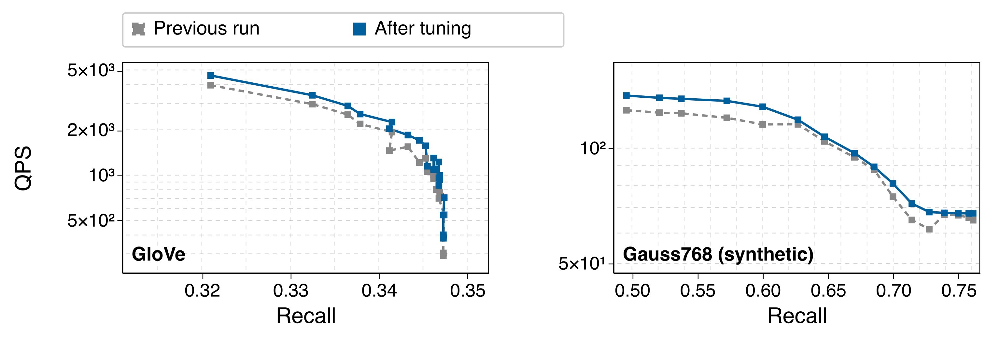

# MLU590 IVF-PQ：调优后的 M32 / M384 结果

> **2026-11-19 GloVe 口径更正：** 本页 GloVe 使用未归一化原始向量和平方 L2 真值，不能用于 angular/cosine 论文对比。归一化后的三组 CPU/MLU 构建、66点查询与新曲线见 [GloVe 余弦重跑](../../2026-11-19/ivfpq-glove-cosine/README.md)。本页旧记录保留追溯，不能把两种距离口径的召回差解释为同一任务提升。

基于 GitHub main `a010611aba6d1f889172fc4fe250ab2f56ec1302`，先用上游 `bench/tune_tensor_tiles.py` 调优并独立复核，再冻结每个数据集的一套执行参数，完成 GloVe 22 点、Gauss768 16 点正式重测。官方调优模块未修改。

本目录与父目录的早期 GloVe-1M/M25 基准分开保存。图中 Previous run 来自 [comparison/previous-run/](comparison/previous-run/)，是同数据、同 M32/M384 索引的上一轮密集测量。

## 最终参数

| 参数 | GloVe | Gauss768 |
|---|---:|---:|
| base / 原始维度 | 1,183,514 / 200 | 1,000,000 / 768 |
| `nlist` | 1024 | 1024 |
| `m` / `nbits` | 32 / 8 | 384 / 8 |
| PQ 工作维度 / 子空间维度 | 224 / 7 | 768 / 2 |
| PQ 变换 | random orthogonal | identity |
| `torch_query_tile_size` | 16 | 64 |
| `torch_candidate_chunk_size` | 2048 | 1024 |
| `torch_max_tasks_per_batch` | 256 | 256 |
| `torch_memory_budget_mb`（MiB） | 1024 | 1024 |
| `torch_lut_chunk_size` | 32 | 64 |
| `torch_pq_lookup` | gather | gather |
| `torch_min_query_tile_size` | 1 | 1 |

共同检索参数：`device=mlu:0`、`backend=torch`、`topk=10`、`torch_query_batch_size=128`、`torch_pq_scan=grouped`、`lut_dtype=fp16`、`persist_layout=False`、`use_compile=False`、CPU 线程 1、TF32 关闭。使用原生 uint8 PQ 编码；未启用 P800 int8 兼容开关。workspace 是调度预算，不是实测进程显存。

共同索引训练参数：残差 PQ、squared L2、`seed=1234`、`coarse_niter=25`、`pq_niter=50`、`coarse_n_init=1`、`pq_n_init=2`、`coarse_trainset_fraction=0.5`、`pq_max_points_per_centroid=512`。本轮复用索引，没有重新训练或修改码本；前后 SHA256 一致。

完整 API 参数名及逐数据集 nprobe 网格见 [params.json](params.json)，实际冻结记录见 [tuning/frozen-settings.json](tuning/frozen-settings.json)。

## 结果

| 数据集 | 点数 | 全曲线 QPS 比值几何平均（相对上一轮） | nprobe=1024 QPS | Recall@10 | 复用的 Build / 秒 |
|---|---:|---:|---:|---:|---:|
| GloVe M32 | 22 | 1.247× | 381.22 | 34.73% | 6.6151 |
| Gauss768 M384 | 16 | 1.060× | 67.54 | 76.12% | 147.9163 |

38 点的 Recall 与上一轮完全一致。Build 数值来自本次复用索引的上轮实际构建，不能理解为本轮重新建库计时。保存时间另见 `results/Build/`。没有补填本轮未测量的进程显存；查询 allocator 指标只保留在原始 JSON 中。

[SVG 矢量图](figures/MLU590_IVFPQ_Tuned_Comparison_Batch128.svg)；图中保留两轮全部 22/16 个点，按 nprobe 连线，不平滑、不删除低效点。

## 调优与测量口径

- 调优使用 `query[0:128]`，固定 GloVe nprobe=240、Gauss nprobe=650。每个候选先校验输出，再做三次设备同步的驻留 batch 计时取中位数。
- A 轮搜索 tile `[8,16,32,64]`、chunk `[512,1024,2048]`、查表 `[flat,gather]`；B 轮固定 A 的最快显式配置，搜索任务批量 `[64,256,512]`、workspace `[128,256,512,1024]` MiB、LUT 分块 `[8,16,32,64,128]`；C 轮对 B 的 tile/chunk 做半倍、原值、两倍邻域复核并再次比较两种查表方式。
- 每数据集 A/B/C 分别记录 25/61/19 次配置测量，包含每阶段的默认参考。两数据集合计 210 次配置测量，重复配置保留；这是分阶段搜索，不声称全局穷举最优。
- 各阶段最快显式候选和上一轮固定配置，在独立的 `query[512:640]`、`query[768:896]` 上复核。GloVe nprobe `[80,240,700]`，Gauss `[400,650,1000]`，六案例中每案例不得低于旧配置的 90%，再按几何平均 QPS 选参。所选配置在复核中的几何平均加速分别为 1.222×、1.038×；该诊断 batch 计时与上表完整查询曲线分开。
- 正式测量使用全部 1000 条查询，batch128、末批补齐、输入驻留设备。每点完整预热两轮、同步计时三轮，QPS=1000/三轮完整查询耗时中位数。另做 Recall/访问量统计，排除其时间以及输入传输和结果回传。每数据集在整条曲线上固定一套参数。
- 调优模块 10 项测试通过（2 条厂商/弃用警告）。[audit.json](audit.json) 记录本地复核：38 点 CSV/JSON 一致、计时中位数重算、独立复核评分重算、冻结参数匹配、源码校验值匹配，以及前后索引哈希一致。

## 环境与数据边界

单张 MLU590-M9DG 80 GiB（卡 0）；2×AMD EPYC 9K84，192 物理核/384 线程，1.5 TiB 主存。TencentOS 4 宿主、Ubuntu 24.04 容器；驱动 6.5.48、固件 1.1.2、CNToolkit 4.4.3。Conda `tensorvs`：Python 3.10.20、PyTorch 2.7.1+cpu、torch_mlu 1.29.2+torch2.7.1、NumPy 1.26.4。仓库声明 Python≥3.11，本次保留厂商 3.10 环境。完整清单及采样来源见 [environment/](environment/)，运行源码版本见 [source-revision.json](source-revision.json)。本轮只安装测试依赖，没有更新驱动或 Torch。

GloVe 使用官方 ANN-Benchmarks 完整 train（1,183,514 条），test 前 1000 条查询，float32、不归一化，重新计算全 train 的 exact squared-L2 top100；没有使用原始 angular groundtruth。它与昇腾记录的 1,193,514 条仍有 10,000 条差异。

Gauss768 是按要求自行生成的 1M 标准正态向量（NumPy PCG64 seed=20261118，先 base 后独立 query），不是论文真实工业 Hunyuan。输入/索引身份没有与昇腾完全对齐，因此本目录只比较同索引的 MLU 调优前后结果，不给出严格跨硬件加速比。数据校验值见 [data/](data/)。

原始正式 JSON 的 `config.alignment_status` 继承自上轮记录；该历史说明不能代表本轮与昇腾的执行参数完全一致。本轮执行配置以 `selected_execution`、`params.json` 和 `frozen-settings.json` 为准。

仅上传参数、结果、调优报告、环境记录和图；不上传复现包、源码快照、运行脚本、原始日志、向量或索引本体。
