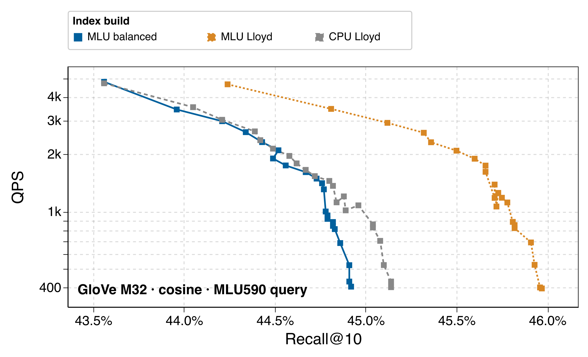

# GloVe M32：余弦口径更正与 CPU / MLU 构建对照

此前寒武纪 GloVe 实验使用未归一化的原始向量，并以原始平方 L2 重算 ground truth，不能用于论文 angular/cosine 召回对比。本次将 **base 和 query 都逐行 L2 归一化**，用归一化全量 base 的精确 inner product 重算真值，重新构建三组 IVF-PQ 索引；每组完成 22 个查询点，查询统一在单张 MLU590 上执行。

归一化单位向量满足 `squared_L2 = 2 - 2*cosine_similarity`，因此沿用 TensorVS 的平方 L2 搜索即可评估余弦邻居。旧 L2 与新余弦 top-10 平均仅重合 **27.44%**；旧结果与本目录是不同检索目标，不能把数值差异解释为同一任务的性能提升。

## 完整结果

GloVe 1,183,514×200，1000 queries，M32 / 8bit / nlist1024，batch128、K10、FP16 LUT。`MLU balanced` 的 IVF/PQ 均用 balanced，另外两组均用 Lloyd。

| 索引构建 | Recall@10 / nprobe400 | QPS / nprobe400 | Recall@10 / nprobe1024 | QPS / nprobe1024 | 完整 Build / 秒 |
|---|---:|---:|---:|---:|---:|
| MLU balanced | 44.83% | 809.64 | 44.92% | 404.33 | 6.4348 |
| MLU Lloyd | 45.82% | 819.31 | **45.97%** | 395.54 | 23.6865 |
| CPU Lloyd（16 线程） | 45.04% | 825.74 | 45.14% | 401.77 | 582.4607 |

[SVG 矢量图](figures/MLU590_GloVe_M32_Cosine_CPU_vs_MLU.svg) · [逐点 CSV/JSON](results/) · [汇总 JSON](summary.json) · [完整测量说明](测量汇总.txt)。图保留每组全部 22 个点，按 nprobe 连线，不平滑、不删点。

此次固定配置和 seed 下，MLU Lloyd 的召回高于另外两组；CPU 构建没有超过 MLU Lloyd。CPU/MLU 的随机数实现不同，同 seed 不保证 kmeans++ 初始中心逐位一致，本实验不把差异全部归因于浮点数值或设备实现。

## 数据与训练

- 来源：官方 ANN-Benchmarks GloVe-200 HDF5 的完整 train；查询保持官方 test 前 1000 行。原始文件身份与新归一化文件 SHA256 见 [data/manifest.json](data/manifest.json)。没有把 test 拼入 base。
- 两侧独立逐行归一化：float64 求范数与除法，转 float32 存储；不存在零范数或非有限输入。base/query 的最大单位范数误差分别为 `2.66e-8` / `1.78e-8`，见 [normalization-check.json](data/normalization-check.json)。
- Ground truth：Faiss `IndexFlatIP`，对全部归一化 base 精确计算每条 query 的 top100；保存的距离为 `1-inner_product`。没有复用旧原始 L2 真值。
- `seed=1234`；IVF 25 轮、1 次初始化、训练比例 0.5；PQ 50 轮、2 次初始化、每中心最多 512 点；均为 kmeans++ 初始化。200→224 工作维度、32 个宽度为 7 的子空间。
- 三组精确复用同一份 224×200 旋转矩阵，以隔离构建设备和训练算法。矩阵数值检查的列正交最大误差为 `3.21e-7`，抽样 L2 距离最大相对误差为 `1.80e-7`；观测来源见 [verification/rotation-check-observation.json](verification/rotation-check-observation.json)。这仅排查数值异常，未证明旋转不会改变 PQ 量化效果。

完整训练/API 参数及 nprobe 网格见 [params.json](params.json)。每组 33 个训练阶段都记录并断言实际构建设备，结果见各组 `cpu-training-stages.json`；该历史文件名用于三组，并不表示 MLU 组在 CPU 训练。

## 执行参数与测量

共同查询配置：`device=mlu:0`、`backend=torch`、`topk=10`、batch128、grouped scan、FP16 LUT、query tile16、candidate chunk2048、tasks256、workspace1024 MiB、LUT chunk32、gather，`torch_min_query_tile_size=1`，compile/TF32 关闭，CPU 查询线程 1。

沿用此前选定的搜索配置以控制变量，**没有在归一化数据上重新调优**，不声称本轮 QPS 为重新寻优后的最优值。

- 每点用全部 1000 条驻留查询，末批填充到128；2次完整预热、3次设备同步完整查询计时取中位数，QPS=1000/中位耗时。原始三次耗时保留在 JSON。
- Recall 和访问数另测，排除输入传输、结果回传及统计时间。nprobe1024 每查询访问完整的 1,183,514 条 base。
- 完整 Build 包括 IVF 聚类、PQ 训练、全量编码；不含加载、SHA 验证、数据归一化、真值计算、QR 重新生成及序列化。三组均为本次完整实测，保存时间另列 JSON。
- Build 进程峰值 RSS 是 CPU 内存，不能当作 MLU 峰值显存；本轮未测量的 Build 设备峰值显存保持空值，不用查询内存代替。
- nprobe400/1024 都以 FP32 LUT 独立核对全部1000查询；MLU balanced 和 CPU Lloyd 两种精度的 Recall 一致，MLU Lloyd 差 `0.01` 个百分点。

原始 Build JSON 沿用了 `lloyd_coarse_inertia` / `lloyd_pq_training_inertia` 字段名；实际算法以 `coarse_kmeans_method` / `pq_kmeans_method` 为准。派生 [summary.json](summary.json) 使用中性的 inertia 字段名。标记为 `previous_raw_l2_*_not_comparable` 的旧训练目标值不参与新口径比较。

## 环境与验证

单张 MLU590-M9DG 80 GiB（卡0），2×AMD EPYC9K84，192物理核/384逻辑线程、1.5 TiB主存。TencentOS4宿主、Ubuntu24.04容器；驱动6.5.48、固件1.1.2、CNToolkit4.4.3。Conda `tensorvs`：Python3.10.20、PyTorch2.7.1+cpu、torch_mlu1.29.2+torch2.7.1、NumPy1.26.4、Faiss1.8.0。CPU构建16线程，MLU构建/所有查询的CPU线程为1。详见 [environment.json](environment.json)；硬件/操作系统清单复用同主机的 [既有采样](../../2026-11-18/ivfpq-tuned/environment/)，运行时版本保留在逐组 provenance。

源码 `a010611aba6d1f889172fc4fe250ab2f56ec1302`，flash-kmeans `2c3c68481761caea2c6100f9bd5c951dc04271f8`；实际远端核心源码 SHA256 与本地版本一致，未改搜索内核。见 [source-revision.json](source-revision.json) 和 [verification/source-sha256.txt](verification/source-sha256.txt)。

[audit.json](audit.json) 已核对三组66点完成状态、归一化数据/真值身份、33阶段实际构建设备、训练与查询参数、脚本/源码哈希、原索引未变、旋转矩阵复用、CSV/JSON一致、计时中位数与QPS复算、全扫描访问量及精度诊断。

其他卡原报告的 base 数量为1,193,514，与本次官方 train 仍差10,000条；其他卡输入、查询及索引身份尚未逐字节对齐，本目录不据此声称严格跨硬件复现或加速比。

本目录上传结果、参数、图、数据身份、环境与核验记录；按此前约定不上传复现包、运行脚本、源码快照、日志、向量或索引本体。历史原始 L2 记录保留在 [2026-11-18](../../2026-11-18/README.md)，其 GloVe 结果不能作为本次余弦基准。
